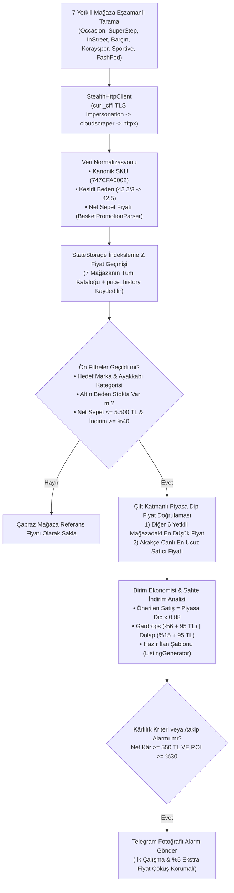

<div align="center">


<br/>

[](https://github.com/yukselyslcmn/arbitraj-botu/actions)
[](https://www.python.org/)
[](#%EF%B8%8F-proje-dizin-ve-mod%C3%BCl-mimarisi)
[](#-telegram-bildirim-kart%C4%B1-ve-interaktif-komutlar)

**Türkiye'deki 7 yetkili orijinal spor ayakkabı distribütörünü (`Occasion`, `SuperStep`, `InStreet`, `Barçın`, `Korayspor`, `Sportive`, `FashFed`) eşzamanlı tarayan, sepetteki gizli indirimleri hesaplayan, `7 Mağaza Çapraz Fiyat İndeksi + Akakçe` ile gerçek piyasa dip fiyatını doğrulayan, ikinci el platformları (`Gardrops`, `Sahibinden`, `Letgo`, `Dolap`) için net kâr / ROI analizi + hazır ilan şablonu üreten ve Görsel Web Kontrol Paneli sunan otonom arbitraj radarı.**

</div>

---

## 🎯 Neden Bu Sistem?

Standart fiyat takip botları yalnızca **vitrin fiyatına** ve **şişirilmiş liste fiyatına** bakar. Oysa gerçek flipping ve arbitraj fırsatları:
1. **Sepette Ekstra İndirimlerde** (*"Sepette %30 İndirim"*, *"3000 TL Üzerine 750 TL İndirim"*),
2. **En Hızlı Nakde Dönen Altın Bedenlerde** (`Erkek: 41–46`, `Kadın: 37–40.5` — `42 2/3` ve `40.5` gibi kesirli/buçuklu bedenler dahil),
3. **7 Yetkili Orijinal Mağaza + Akakçe Çapraz Fiyat Doğrulamasında**,
4. **Fiyat Geçmişi (`price_history`) ve Sahte İndirim Tespiti (`is_inflated_retail_price`)** analizinde gizlidir.

<div align="center">
  
</div>

---

## 🏪 Taranan 7 Yetkili Orijinal Mağaza ve Çapraz Kıyaslama

Sistem yalnızca **%100 orijinal ve faturalı** ürün satan Türkiye'nin 7 büyük yetkili distribütörünü tarar ve her mağazanın hem indirimli hem de normal fiyatlı kataloglarını `data/products_state.json` içinde indeksleyerek **birbirleriyle ve Akakçe ile** kıyaslar:

| Yetkili Mağaza | Altyapı / Veri Kaynağı | Yakalanan Özel Kampanya & Veri Türü |
| :--- | :--- | :--- |
| **Occasion** (`occasion.com.tr`) | Akinon JSON API + Detay Zenginleştirme | Sepette ekstra `%` / `TL` indirimler, kesirli beden stokları (`1/3`, `2/3`, `.5`) |
| **SuperStep** (`superstep.com.tr`) | Akinon JSON API + Kampanya Rozetleri | Outlet + Yeni sezon sneaker kataloğu, sepet içi otomatik indirim kuralları |
| **InStreet** (`instreet.com.tr`) | Next.js App Router (`self.__next_f.push`) | `ruleInfo` sepet fiyatları, `animatedBadgeList` kampanyaları, varyant bazlı stok |
| **Barçın** (`barcin.com`) | Akinon JSON + HTML Fallback | Nike / Jordan / Adidas yetkili distribütör stokları ve outlet sepet indirimleri |
| **Korayspor** (`korayspor.com`) | Next.js `__NEXT_DATA__` SSR + Detay Beden | İndirimli ve sezon spor ayakkabı kataloğu, anlık beden kırılımı |
| **Sportive** (`sportive.com.tr`) | Akinon JSON API + Outlet Kataloğu | Nike, Adidas, Puma, Asics, Salomon yetkili distribütör outlet & sezon fiyatları |
| **FashFed** (`fashfed.com`) | Akinon JSON API + Flash İndirimler | Dunk, Handball Spezial, Air Force 1, Gazelle, New Balance 530/9060 flaş indirimleri |
| **Akakçe** (`akakce.com`) | Canlı Piyasa Doğrulayıcı (`span.pt_v9/v8`) | Trendyol Plus, Hepsiburada, Amazon, Boyner dahil **en ucuz satıcı** doğrulaması |

---

## 📱 Telegram Bildirim Kartı ve İnteraktif Komutlar

Fırsat yakalandığında Telegram botunuz üzerinden ürün fotoğrafı, tam maliyet/kâr tablosu, fiyat geçmişi trend rozeti (`📉 Tüm Zamanların En Dip Fiyatı!`), **tek tıkla kopyalanabilir hazır Gardrops/Dolap ilan başlığı** ve satın alma butonlarıyla birlikte anında telefonunuza düşer:

<div align="center">
  
</div>

### 🤖 İnteraktif Telegram Komutları (`core/telegram_bot_commands.py`)
Bota Telegram üzerinden doğrudan mesaj göndererek sistemi yönetebilirsiniz:
* `/durum` — 7 yetkili mağazadan indekslenen benzersiz model sayısını, mağaza dağılımını ve aktif filtre eşiklerini gösterir.
* `/firsatlar` — Veritabanındaki en yüksek net kârlı ve ROI'li ilk 5 arbitraj fırsatını listeler.
* `/ara <model veya SKU>` — Örneğin `/ara IF6491` veya `/ara Handball Spezial` yazdığınızda tüm yetkili mağaza fiyatlarını, Akakçe dip fiyatını, net kâr hesabını ve **kopyalanmaya hazır ilan şablonunu** döndürür.
* `/filtre <min_kar_tl> <min_roi_yuzde>` — Bildirim eşiklerini (Örn: `/filtre 600 30`) kalıcı olarak günceller.
* `/takip <SKU> <hedef_fiyat>` — Belirtilen ürünü (Örn: `/takip IF6491 3200`) özel fiyat alarm listesine ekler.

---

## 🧠 Algoritma ve Karar Akış Şeması



---

## 🧮 Matematiksel Kâr, ROI ve Puanlama Formülleri

Bot, ürünün şişirilmiş liste fiyatına (`retail_price`) **asla güvenmez**; liste fiyatı piyasa dip fiyatının `1.55` katından yüksekse `⚠️ Şişirilmiş Liste Fiyatı` uyarısı basar ve kâr hesabını yalnızca **7 yetkili mağaza çapraz kıyaslaması ve Akakçe'deki en ucuz satıcı fiyatından (`market_floor_price`)** yapar:

1. **Hızlı Nakde Dönüş (Quick-Flip) Satış Fiyatı:**
   $$\text{Önerilen Satış Fiyatı} = \text{Piyasa Dip Fiyatı} \times (1 - 0.12)$$
2. **Gardrops / Sahibinden / Letgo Net Kârı (`%6` Hizmet Bedeli + `95 TL` Kargo/Paketleme):**
   $$\text{Net Kâr}_{\text{Gardrops}} = (\text{Önerilen Satış} \times 0.94) - 95\,\text{TL} - \text{Sepette Net Alış}$$
3. **Dolap Net Kârı (`%14` Komisyon + `%1` Hizmet + `95 TL` Kargo):**
   $$\text{Net Kâr}_{\text{Dolap}} = (\text{Önerilen Satış} \times 0.85) - 95\,\text{TL} - \text{Sepette Net Alış}$$
4. **Yatırım Getirisi (ROI %):**
   $$\text{ROI (\%)} = \left( \frac{\text{Net Kâr}_{\text{Gardrops}}}{\text{Sepette Net Alış}} \right) \times 100$$

---

## 🗂️ Proje Dizin ve Modül Mimarisi

```text
arbitraj-botu/
├── assets/
│   ├── hero-banner.svg              # README üst kapak görseli
│   ├── architecture-flow.svg        # 4 aşamalı mimari akış görseli
│   └── telegram-card-preview.svg    # Telegram bildirim kartı görseli
├── core/
│   ├── http_client.py               # TLS Impersonation (curl_cffi -> cloudscraper -> httpx) + Token Maskeleme
│   ├── parsers.py                   # SizeNormalizer (kesirli/buçuklu beden) & BasketPromotionParser
│   ├── arbitrage_engine.py          # Net kâr, ROI, Sahte İndirim Tespiti ve Arbitraj Puanı (1-100)
│   ├── listing_generator.py         # Gardrops / Dolap / Sahibinden hazır ilan başlığı ve açıklama üretici
│   ├── storage.py                   # 7 mağaza çapraz fiyat veritabanı, price_history ve /takip listesi
│   ├── notifier.py                  # Telegram Bot API (sendPhoto + sendMessage fallback)
│   └── telegram_bot_commands.py     # İnteraktif Telegram komut işleyici (/durum, /firsatlar, /ara, /filtre, /takip)
├── scrapers/
│   ├── base_scraper.py              # Ortak kazıyıcı şablonu ve JSON-LD / Next.js ayrıştırıcı
│   ├── akinon_scraper.py            # Occasion, SuperStep, Barçın, Sportive ve FashFed kazıyıcısı
│   ├── instreet_scraper.py          # InStreet Next.js App Router (__next_f) kazıyıcısı
│   ├── barcin_koray_scraper.py      # Korayspor (__NEXT_DATA__ SSR) ve Barçın hibrit kazıyıcısı
│   └── market_comparator.py         # 7 Yetkili Mağaza + Akakçe canlı piyasa doğrulayıcı
├── data/
│   └── products_state.json          # Çapraz mağaza fiyat indeksi, fiyat geçmişi ve bildirim hafızası
├── .github/workflows/
│   └── arbitrage_radar.yml          # GitHub Actions 7/24 bulut otomasyon iş akışı
├── config.py                        # Eşik değerleri, altın bedenler, hedef markalar ve 7 mağaza hedefi
├── main.py                          # Çoklu iş parçacıklı (ThreadPool) ana orkestratör
├── dashboard.py                     # Görsel Web Kontrol Paneli ve Canlı Kâr/ROI Simülatörü (Port 8080)
├── 1_KURULUM_YAP.bat                # Tek tıkla Windows sanal ortam ve kütüphane kurulumu
├── 2_TEK_SEFERLIK_TEST_ET.bat       # Tek tıkla canlı test taraması
├── 3_BOTU_7_24_DONGUDE_CALISTIR.bat # Tek tıkla yerel 15 dakikalık kesintisiz döngü
├── 4_TELEGRAM_KOMUT_BOTU.bat        # Tek tıkla interaktif Telegram komut dinleyicisi
└── 5_WEB_PANELINI_AC.bat            # Tek tıkla görsel Web Kontrol Paneli başlatıcı
```

---

## 🚀 Hızlı Kurulum ve Çalıştırma

### 1. Ortamı Kurun
Windows üzerinde tek tıkla kurulum için `1_KURULUM_YAP.bat` dosyasına çift tıklayabilir veya terminalden çalıştırabilirsiniz:

```powershell
python -m venv venv
.\venv\Scripts\pip.exe install -r requirements.txt
```

### 2. `.env` Yapılandırması
Proje kök dizininde `.env.example` dosyasını `.env` olarak kopyalayın ve kendi bilgilerinizi girin:

```env
TELEGRAM_BOT_TOKEN=1234567890:AAH_ornek_bot_token_buraya_gelecek
TELEGRAM_CHAT_ID=-1001234567890
MIN_NET_PROFIT_TL=550
MIN_ROI_PERCENT=30
MAX_BASKET_PRICE=5500
MIN_TOTAL_DISCOUNT_RATE=40
```

### 3. Çalıştırma Modları

* **Tüm 7 Yetkili Mağazayı Tek Seferlik Canlı Tarama:**
  ```powershell
  .\venv\Scripts\python.exe main.py --once
  ```
* **Görsel Web Kontrol Panelini Açma (`http://127.0.0.1:8080`):**
  `5_WEB_PANELINI_AC.bat` dosyasına çift tıklayın veya:
  ```powershell
  .\venv\Scripts\python.exe dashboard.py
  ```
* **İnteraktif Telegram Komut Botunu Dinleme (`/ara`, `/firsatlar`, `/filtre`, `/takip`):**
  `4_TELEGRAM_KOMUT_BOTU.bat` dosyasına çift tıklayın veya:
  ```powershell
  .\venv\Scripts\python.exe main.py --listen-commands
  ```
* **Bilgisayarda 7/24 Kesintisiz (Tam 15 Dakikada Bir) Çalıştırma:**
  `3_BOTU_7_24_DONGUDE_CALISTIR.bat` dosyasına çift tıklayın veya:
  ```powershell
  .\venv\Scripts\python.exe main.py --loop
  ```
