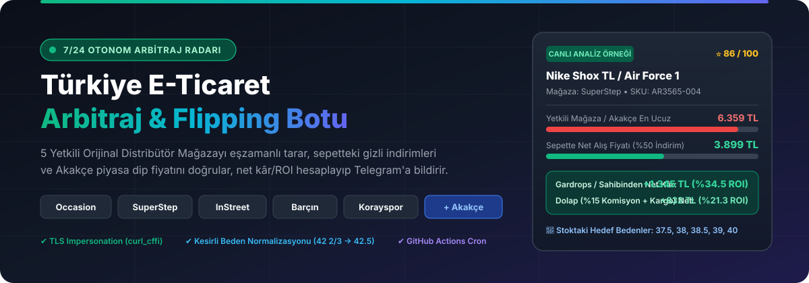
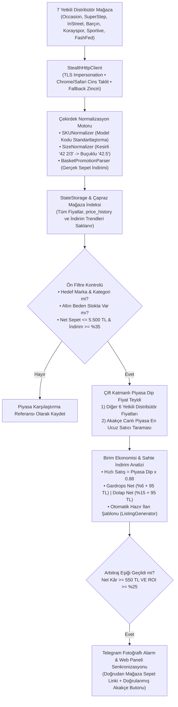
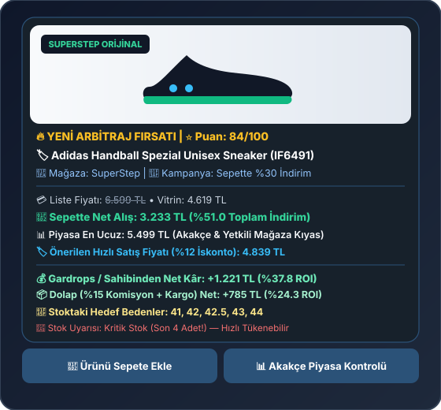

<div align="center">



<br/>

[](https://yukselyslcmn.github.io/arbitraj-botu/)
[](https://github.com/yukselyslcmn/arbitraj-botu/actions)
[](https://www.python.org/)
[](#-ak%C4%B1ll%C4%B1-veri-kaz%C4%B1ma-ve-stealth-altyap%C4%B1)
[](#-telegram-bildirim-ve-interaktif-komut-istasyonu)

**Türkiye'nin 7 büyük yetkili orijinal spor ayakkabı distribütörünü (`Occasion`, `SuperStep`, `InStreet`, `Barçın`, `Korayspor`, `Sportive`, `FashFed`) eşzamanlı tarayan, sepetteki gizli indirimleri sahte afişlerden arındırarak hesaplayan, `Çapraz Mağaza İndeksi + Akakçe Model/SKU Hibrit Doğrulaması` ile gerçek piyasa dip fiyatını bulan, ikinci el platformları (`Gardrops`, `Sahibinden`, `Letgo`, `Dolap`) için net kâr / ROI analizi ve hazır ilan şablonu üreten otonom arbitraj radarı.**

[🌐 Canlı Bulut Kontrol Panelini Aç (GitHub Pages)](https://yukselyslcmn.github.io/arbitraj-botu/) • [🤖 Telegram Bot Entegrasyonu](#-telegram-bildirim-ve-interaktif-komut-istasyonu) • [📊 Mimari Akış](#-mimari-ak%C4%B1%C5%9F-%C5%9Femas%C4%B1) • [🚀 Kurulum](#-h%C4%B1zl%C4%B1-kurulum-ve-%C3%A7al%C4%B1%C5%9Ft%C4%B1rma)

</div>

---

## 💡 Neden Bu Sistem? (Fark Yaratan Çekirdek Yetenekler)

Geleneksel fiyat takip araçları yalnızca **vitrin fiyatına** veya **şişirilmiş liste fiyatına** odaklanır. Arbitraj botu ise piyasada gerçek kârlılık yaratan kritik detayları milimetrik çözer:

1. **Sepetteki Gizli İndirimleri Yakalar, Genel Sloganları Reddeder:**  
   *"Sepette %25 İndirim"*, *"3.000 TL Üzerine 750 TL İndirim"* gibi net sepet indirimlerini kuruşu kuruşuna çözerken; *"Sepette %60'a varan indirim"*, *"2. ürüne %50"* gibi afiş niteliğindeki yanıltıcı kampanya metinlerini filtreleyerek sahte kâr alarmlarını (%100) engeller.
2. **Altın Beden & Kesirli Numara Normalizasyonu (`SizeNormalizer`):**  
   Hızlı nakde dönen erkek (`41–46`) ve kadın (`37–40.5`) bedenlerini hedefler. Adidas, Salomon ve New Balance kesirli numaralarını (`42 2/3`, `43 1/3`, `40.5`) otomatik olarak standart buçuklu numaralara dönüştürerek stoğu teyit eder.
3. **Akıllı Çift Katmanlı Piyasa Doğrulaması (`MarketComparator`):**  
   * **Global SKU Markaları (Nike, Adidas, Puma, Salomon vb.):** Üretici model kodu (`CW2288-111`, `ID1488`, `L47440800`) ile Akakçe'deki tüm pazar yeri satıcılarını eşleştirir.
   * **Model Bazlı Markalar (Lacoste, Converse, Vans, Timberland vb.):** Mağazaların dahili ERP barkodları yerine temiz model adıyla (`Lacoste AG-LT25 Lite`, `Lacoste Baseshot`, `Converse Chuck 70`) Akakçe'de arama yapar; alakasız ürün ve boş sonuç çıkmasını önler.
4. **Birebir Doğru Yönlendirme:**  
   Telegram bildirimlerinde ve web panelinde yer alan **"Hemen Sepete Ekle"** butonu her zaman doğrudan orijinal distribütör ürün sayfasına; **"Akakçe Piyasa"** butonu ise Akakçe'deki ilgili modelin piyasa fiyat sayfasına yönlendirir.

---

## 📊 Mimari Akış Şeması



---

## 🏪 Taranan 7 Yetkili Distribütör ve Veri Kaynakları

Sistem yalnızca **%100 orijinal ve resmi faturalı** ürün satan Türkiye distribütörlerini tarar:

| Mağaza | Altyapı | Yakalanan Veri & Kampanyalar | Doğrulama Yöntemi |
| :--- | :--- | :--- | :--- |
| **Occasion** (`occasion.com.tr`) | Akinon JSON API | Lacoste, Gant, Nautica, Converse sepet indirimleri & kesirli bedenler | Model Adı + Çapraz Mağaza |
| **SuperStep** (`superstep.com.tr`) | Akinon JSON API | Outlet & Yeni sezon sneaker kataloğu, buçuklu/kesirli stoklar | Model Adı + Akakçe |
| **InStreet** (`instreet.com.tr`) | Next.js App Router | `ruleInfo` sepet kampanyaları, `animatedBadgeList` indirimleri | Model Kodu / SKU |
| **Barçın** (`barcin.com`) | Akinon + HTML | Nike, Jordan, Puma yetkili distribütör stokları ve outlet sepeti | Global SKU |
| **Korayspor** (`korayspor.com`) | Next.js SSR | İndirimli spor ayakkabı kataloğu, anlık numara stok matrisi | Global SKU |
| **Sportive** (`sportive.com.tr`) | Akinon JSON API | Nike, Adidas, Puma, Asics, Salomon outlet ve sezon fırsatları | Global SKU |
| **FashFed** (`fashfed.com`) | Akinon JSON API | Dunk, Spezial, Gazelle, New Balance 530/9060 flaş sepet indirimleri | Global SKU |
| **Akakçe** (`akakce.com`) | Canlı Piyasa API | Amazon, Hepsiburada, Trendyol, idefix, Pazarama en ucuz resmi satıcı teklifleri | Akıllı Hibrit (SKU / Model) |

---

## 📱 Telegram Bildirim ve İnteraktif Komut İstasyonu

Arbitraj fırsatı yakalandığında fotoğrafı, hedef numaraları, net alış/satış tutarları ve **tek tıkla kopyalanabilir ilan başlığıyla** anında Telegram'a gönderilir:

<div align="center">
  
</div>

### 🤖 Kullanılabilir Telegram Komutları

Botla Telegram üzerinden konuşarak tüm sistemi uzaktan yönetebilirsiniz:

* `/panel` — Güncel fırsatları ve piyasa verilerini gösteren [Canlı Bulut Web Paneli Linkini](https://yukselyslcmn.github.io/arbitraj-botu/) anında iletir.
* `/durum` — Veritabanındaki ürün sayısını, mağaza dağılımını ve aktif kârlılık filtrelerini özetler.
* `/firsatlar` — Sistemde o an bulunan en yüksek kârlı ve en popüler ilk 5 fırsatı listeler.
* `/ara <model veya SKU>` — Örneğin `/ara IF6491` veya `/ara AG-LT25` yazdığınızda tüm mağaza fiyatlarını, piyasa dip fiyatını ve kopyalanmaya hazır ilan metnini üretir.
* `/filtre <min_kar_tl> <min_roi>` — Bildirim eşiklerini (Örn: `/filtre 600 30`) anında ve kalıcı olarak günceller.
* `/takip <SKU> <hedef_fiyat>` — Belirtilen ürünü özel fiyat alarm listesine alır; fiyat o seviyeye düştüğünde anında alarm verir.

---

## 🧮 Matematiksel Kâr, ROI ve Puanlama Formülleri

> [!IMPORTANT]
> Sistem, mağazaların şişirilmiş liste fiyatlarına (`retail_price`) **asla güvenmez**; kâr hesabı yalnızca **7 yetkili distribütörün çapraz fiyatı ve Akakçe'deki en ucuz satıcı dip fiyatı (`market_floor_price`)** baz alınarak yapılır.

1. **Hızlı Nakde Dönüş (Quick-Flip) Satış Fiyatı:**
   $$\text{Önerilen Satış Fiyatı} = \text{Piyasa Dip Fiyatı} \times 0.88$$
2. **Gardrops / Sahibinden / Letgo Net Kârı (`%6` Hizmet Bedeli + `95 TL` Kargo):**
   $$\text{Net Kâr}_{\text{Gardrops}} = (\text{Önerilen Satış} \times 0.94) - 95\,\text{TL} - \text{Sepette Net Alış}$$
3. **Dolap Net Kârı (`%14` Komisyon + `%1` Hizmet + `95 TL` Kargo):**
   $$\text{Net Kâr}_{\text{Dolap}} = (\text{Önerilen Satış} \times 0.85) - 95\,\text{TL} - \text{Sepette Net Alış}$$
4. **Yatırım Getirisi (ROI %):**
   $$\text{ROI (\%)} = \left( \frac{\text{Net Kâr}_{\text{Gardrops}}}{\text{Sepette Net Alış}} \right) \times 100$$

---

## 🌐 Görsel Web Kontrol Paneli (`dashboard.py`)

Proje, hem yerel makinenizde (`localhost:8080`) çalıştırılabilen dinamik bir FastAPI sunucusu hem de GitHub Pages üzerinde 7/24 barındırılabilen statik bir bulut arayüzü sunar:

* **Filtreleme & Arama:** Marka, mağaza, cinsiyet, asgari kâr (TL), asgari ROI (%) ve model koduna göre anlık arama.
* **Canlı Kâr Simülatörü:** Alış fiyatı veya piyasa dip fiyatı değiştiğinde kârı canlı hesaplama.
* **Doğrudan Mağaza & Akakçe Butonları:** Her fırsat kartında tek tıkla sepete ekleme ve tek tıkla Akakçe fiyat karşılaştırma butonları.

> [!TIP]
> [Canlı Bulut Web Panelini Ziyaret Edin](https://yukselyslcmn.github.io/arbitraj-botu/)

---

## 🚀 Hızlı Kurulum ve Çalıştırma

### 1. Depoyu Klonlayın ve Sanal Ortamı Hazırlayın

```powershell
git clone https://github.com/yukselyslcmn/arbitraj-botu.git
cd arbitraj-botu

python -m venv venv
.\venv\Scripts\pip.exe install -r requirements.txt
```

### 2. Ortam Değişkenlerini (`.env`) Ayarlayın

`.env.example` dosyasını `.env` olarak kopyalayın ve Telegram bilgilerinizi tanımlayın:

```env
TELEGRAM_BOT_TOKEN=1234567890:AAH_ornek_bot_token_buraya_gelecek
TELEGRAM_CHAT_ID=5784345886
MIN_NET_PROFIT_TL=550
MIN_ROI_PERCENT=25
MAX_BASKET_PRICE=5500
MIN_TOTAL_DISCOUNT_RATE=35
PUBLIC_DASHBOARD_URL=https://yukselyslcmn.github.io/arbitraj-botu/
```

### 3. Çalıştırma Seçenekleri

* **Tek Seferlik Canlı Tarama ve Rapor:**
  ```powershell
  .\venv\Scripts\python.exe main.py --once
  ```
* **İnteraktif Telegram Komut Botunu Başlatma:**
  ```powershell
  .\venv\Scripts\python.exe main.py --listen-commands
  ```
* **Görsel Web Kontrol Panelini Açma (`http://127.0.0.1:8080`):**
  ```powershell
  .\venv\Scripts\python.exe dashboard.py
  ```
* **Statik Bulut Paneli Verilerini Derleme (`docs/data.json`):**
  ```powershell
  .\venv\Scripts\python.exe dashboard.py --export-static docs
  ```

---

## 🛡️ Güvenlik ve Anti-Bot Teknolojisi

* **TLS Fingerprint Impersonation:** `curl_cffi` altyapısı sayesinde Cloudflare, Datadome ve Akamai gibi koruma duvarlarına takılmadan gerçek Chrome/Safari tarayıcı imzalarıyla istek atar.
* **Token ve Gizlilik Maskeleme:** Hata günlüklerinde Telegram token ve kullanıcı kimlikleri maskelenerek güvenli tutulur.
* **Otomatik Yedekleme & Fallback:** Cloudscraper ve HTTPX zincirleri ile bağlantı kopmalarına karşı 3 katmanlı yedeklilik sağlar.

---

<div align="center">
  <sub>Geliştirici &amp; Mimari: Yüksel Yeşilçimen • 7/24 Kesintisiz Otonom Arbitraj Radarı</sub>
</div>
